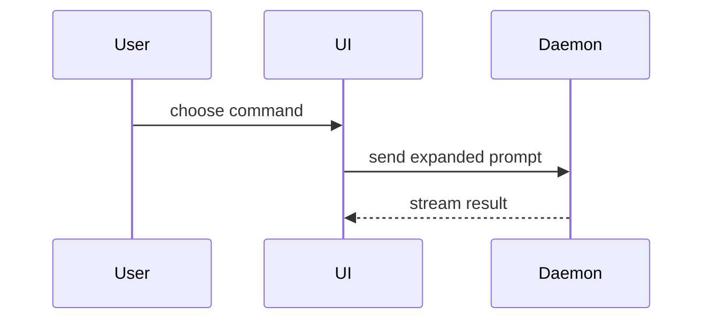

# PR

Open or update the GitHub pull request for this branch. An existing pull
request on the branch is the one to update, never a second. Both title and
body are regenerated from the **net diff**, not an old body. Create ready,
not draft; never flip an existing one to draft; never from the default
branch. This is personal GitHub; squash merge means the PR title becomes the
commit on the default branch. This skill does not commit: if the work is
uncommitted, stop and tell the user to run `commit` first.

## Title

Derive the title from the **net diff**, not the first commit:
`type(scope?): imperative summary`.

Use `feat`, `fix`, `docs`, `style`, `refactor`, `perf`, `test`, `build`, `ci`,
or `chore`. Keep it lowercase, imperative, under 72 characters, and without a
trailing period. Scope only when it sharpens meaning. If the title needs `and`
to join unrelated ideas, stop and say the branch should be split.

## Body

```markdown
## Summary

[The problem or outcome. One short paragraph. Do not restate the title.]

[An optional sketch: the smallest view that makes the change clear.]

## Evidence

**Before:** <output the change improves on>
**After:** <output the change produces>

## Merge Danger

**Door:** <one-way or two-way>

**Blast Radius:** <one word>

[Optional: ramifications of merging.]

## Out of Scope

[Only if a reviewer would reasonably ask why something was left out.]

Closes #123
```

Omit a heading when it has nothing to say. Add `Closes` only for an issue in
the conversation or a known linked issue; never invent one. Do not add a
Testing section; CI is the automated record.

### Summary

Sketch the change when a picture beats prose, and pick the smallest view that
makes the key point clear. You will use one of these, sometimes several; you
will not use all of them. The sketch sits next to the prose it supports, and
a trivial diff needs no sketch.

Pseudocode for logic or an algorithm:

```text
on(save)
  if content is unchanged
    return cached result
  write new content
  return fresh result
```

A call tree for runtime control flow:

```text
submitForm
  createSession
    persistPrompt
    launchAgent
  navigateToSession
```

A component tree for UI structure, including the state and module boundaries
that matter:

```text
<SessionPage> (apps/example/src/routes/session.tsx)
  useSessionEvents()
  <SessionToolbar>
    <RunSkillButton> (packages/ui)
```

A shallow file tree for file responsibility or a broad refactor; whoever owns
what, next to each entry:

```text
src/
├── commands/       # parses user actions
├── sessions/       # owns session state
└── transport/      # sends API requests
```

Sketch the shape, never an inventory of files; reach for the tree only when
ownership or order moved, and keep it shallow.

A mermaid diagram for component interaction, control flow, or data flow:



Use `diff` when the point is what changes. Match the diff shape to the topic.

Component change:

```diff
 <SessionPage>
   useSessionEvents()
   <SessionToolbar>
+    <RunSkillButton />
   <SessionTimeline>
+    <SkillResultsCard />
```

File layout change:

```diff
 src/
 ├── commands/
+│   └── show-me.ts       # expands the slash command
 ├── sessions/
-└── transport.ts
+└── transport/
+    ├── client.ts
+    └── stream.ts
```

Call-tree change:

```diff
 submitForm
   createSession
     persistPrompt
+      expandSkillMention
     launchAgent
-  navigateToSession
+  navigateToSession
+    subscribeToEvents
```

State or control-flow change:

```diff
 on(save)
-  write content
+  if content is unchanged
+    return cached result
+  write content
+  invalidate cache
```

Show the whole block when most of it is new, when omitted context would hide
ownership or order, or when the reviewer needs a copyable target shape:

```ts
function expandSkill(command: string): string {
  const skillName = command.slice(1);
  return `use the ${skillName} skill`;
}
```

### Evidence

Fill the section only when a human must check what CI cannot arbitrate;
otherwise omit it. A screenshot is S-tier evidence when the environment is
set up for it and the change is visual. Execution output is A-tier: test
results and console output. Show the exact test that failed before and passes
after; keep the failing and the passing run.

Never assert a result; show it. Fake or promised evidence is worse than none.
A one-line flag under Summary about something a human must check lands here.

### Merge danger

The door test asks one question: can you walk back through it? A two-way door
you can; a one-way door you cannot, and a PR cheap to roll back is lower
risk. Destructive actions and hard-to-reverse decisions are one-way doors:
migrations, contract changes, irreversible commands.

Blast radius is the potential impact or scope. Consider all of it: layout
shift, breakage for consumers, degraded mobile responsiveness, anything else
the reviewer could wake up to. One word in the template; the optional
ramification line earns its place only when the reviewer would otherwise be
surprised.

Omit the section for a two-way door with a contained radius; the absence
tells reviewers the change is safe and cheap to reverse.

### Out of scope

Only if a reviewer would reasonably ask why something was left out.

Do not restate the title, enumerate files, add fake checklists, use local
paths, or keep a Notes section. Ignore `.github/pull_request_template.md`;
this skill is the convention. Write the body to a temp file and pass
`--body-file`, never a quoted `--body`.

